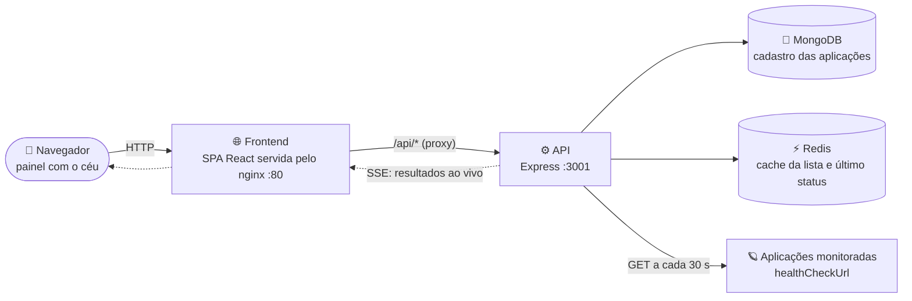

# 🪐 Orbital


[](LICENSE)

Dashboard de monitoramento de saúde de aplicações com visualização orbital. Cada aplicação é representada como um planeta em órbita — o brilho do planeta indica o resultado do último health check.

## 🌌 Conceito

A metáfora orbital transforma um painel de status convencional em uma visualização espacial construída com D3.js. Planetas verdes indicam aplicações saudáveis, âmbar indicam lentidão (degradado) e vermelhos indicam falha; cinza é uma aplicação ainda não verificada. O sistema suporta múltiplos ambientes (desenvolvimento, homologação e produção), cada um com sua própria constelação de aplicações, e agrupa as aplicações em **órbitas**: a home é uma galáxia em que cada órbita é um planeta, e uma aplicação pode estar em várias órbitas.

## 🏗️ Arquitetura

**O servidor verifica, o painel só mostra.** O navegador nunca testa as aplicações: ele recebe os resultados prontos da API por uma conexão que fica aberta.



### Como funciona

1. **A API agenda os checks.** A cada `HEALTH_CHECK_INTERVAL_S` (padrão 30 s) ela faz um `GET` no `healthCheckUrl` de cada aplicação. Os ambientes rodam defasados (produção em 0 s, homologação em 10 s, desenvolvimento em 20 s) para não baterem juntos nos serviços monitorados.
2. **Cada resultado é publicado na hora** no stream SSE `GET /applications/events` e guardado no Redis.
3. **O painel só escuta.** Ao conectar, recebe um snapshot com o último status de cada aplicação; depois, só as mudanças. Recarregar a página nunca dispara um check, e abrir mais abas não gera mais tráfego para as aplicações.
4. **"Sincronizar" força um ciclo** do ambiente na tela (`POST /applications/:env/sync`, que responde `202`). Os resultados chegam pelo mesmo stream.

### Status

| Planeta | Status | Quando |
|---|---|---|
| 🟢 verde | `healthy` | Respondeu 2xx em menos de `DEGRADED_LATENCY_MS` (padrão 3 s) |
| 🟡 âmbar | `degraded` | Respondeu 2xx, mas acima de `DEGRADED_LATENCY_MS` |
| 🔴 vermelho | `unhealthy` | Erro HTTP, falha de rede ou timeout (`HEALTH_CHECK_TIMEOUT_MS`, padrão 5 s) |
| ⚪ cinza | — | Ainda não verificada; entra no próximo ciclo do ambiente |

### Estrutura do código

| Pasta | Conteúdo |
|---|---|
| `frontend/` | SPA em React + TypeScript, buildada com o Vite e servida pelo nginx: a galáxia em `/` e o painel em `/painel` (React Router), com o estado em stores Zustand. Em `src/`: `domain/` (regras puras), `api/`, `storage/`, `store/`, `hooks/`, `viz/` (desenho com d3 e canvas), `components/` e `features/` (galáxia, painel e formulário). O nginx entrega o `index.html` para as rotas da SPA e encaminha `/api/` para a API. |
| `api/` | REST API Node.js + Express em camadas: `routes/` → `controllers/` → `services/` → `repositories/`, mais `config/`, `middlewares/`, `validators/` e `utils/`. |

> [!WARNING]
> Rode a API com **uma única instância**. O agendador e o envio de eventos ficam em memória, então várias réplicas checariam cada aplicação mais de uma vez.

## ✨ Funcionalidades

- 🌌 **Galáxia de órbitas** — a home mostra cada órbita como um planeta, com a quantidade de aplicações e quantas estão fora ou degradadas; clicar abre o painel filtrado por ela
- 🔭 **Visualização orbital** — aplicações como planetas animados em D3.js; a cor reflete o status atual
- 🌍 **Multi-ambiente** — alternância entre Desenvolvimento, Homologação e Produção
- ⏱️ **Health check automático no servidor** — ciclos a cada `HEALTH_CHECK_INTERVAL_S`, com resultados em tempo real via SSE
- 📡 **Sincronização manual** — botão Sincronizar força um ciclo imediato do ambiente na tela
- ➕ **Cadastro de aplicações** — formulário para adicionar nome, time, ambiente, órbitas (escolhidas ou criadas na hora), URL de health check e Swagger
- 🗑️ **Remoção de aplicações** — exclusão com confirmação diretamente no card
- 🔍 **Seleção pela órbita** — clique em um planeta para destacar o card da aplicação (com o link do Swagger)
- 🔎 **Filtros e busca** — filtre por status (no ar / degradado / fora) e busque por nome ou time
- 📄 **Paginação** — lista de aplicações paginada por ambiente
- 🌗 **Tema claro/escuro** — alternância com persistência no localStorage
- 🔔 **Alertas de queda** — notificação do navegador e bipe quando uma aplicação cai com a aba em segundo plano, e contador no título da página
- ⛈️ **Modo tempestade** — se a API fica inacessível, o céu vira tempestade e os status aparecem como "último conhecido" até a conexão voltar

## 🚀 Como utilizar

### Pré-requisitos

- 🐳 [Docker](https://docs.docker.com/get-docker/) com Docker Compose

---

### 🖥️ Modo local

Sobe todos os serviços em containers — ideal para desenvolvimento e testes.

```bash
docker compose -f docker-compose.local.yml up -d --build
```

| Serviço      | URL                        | Descrição               |
|--------------|----------------------------|-------------------------|
| 🌐 Frontend  | http://localhost           | Painel Orbital (nginx)  |
| ⚙️ API       | http://localhost:3001      | REST API                |
| 🍃 MongoDB   | mongodb://127.0.0.1:27017  | Banco de dados (só desta máquina)        |
| 🔴 Redis     | 127.0.0.1:6379             | Cache e último status (só desta máquina) |

> O banco é populado automaticamente com dados de exemplo na primeira inicialização. Nas reinicializações seguintes os dados persistem no volume `mongo_data`.

---

### 🏭 Modo produção

Sobe apenas frontend e API em containers. MongoDB e Redis são serviços externos já existentes (nuvem, on-premise, etc.).

```bash
cp api/.env.prod.example api/.env.prod   # preencha com os dados dos serviços externos
docker compose -f docker-compose.prod.yml up -d --build
```

| Serviço      | URL                   | Descrição              |
|--------------|-----------------------|------------------------|
| 🌐 Frontend  | http://localhost      | Painel Orbital (nginx) |
| ⚙️ API       | http://localhost:3001 | REST API               |

As credenciais dos serviços externos são lidas do arquivo `api/.env.prod`:

| Variável         | Descrição                               |
|------------------|-----------------------------------------|
| `MONGO_URL`      | URL de conexão com MongoDB externo      |
| `MONGO_USER`     | Usuário do MongoDB (opcional)           |
| `MONGO_PASS`     | Senha do MongoDB (opcional)             |
| `MONGO_DB`       | Nome do banco de dados                  |
| `REDIS_URL`      | URL de conexão com Redis externo        |
| `HEALTH_CHECK_INTERVAL_S` | Intervalo (segundos, mínimo 5) entre os health checks agendados de cada ambiente (padrão 30) |
| `APPS_CACHE_TTL` | Validade (segundos) do cache da lista de aplicações no Redis; `0` desliga |
| `HEALTH_CHECK_CONCURRENCY` | Máximo de health checks simultâneos por ciclo |
| `DEGRADED_LATENCY_MS` | Tempo de resposta (ms) acima do qual a aplicação fica degradada |
| `HEALTH_CHECK_TIMEOUT_MS` | Tempo máximo (ms) de cada health check antes de marcar a aplicação como fora do ar |
| `CORS_ORIGINS`   | Origens liberadas para chamar a API direto do navegador (vazio = nenhuma; veja abaixo) |
| `LOG_LEVEL`      | Nível mínimo dos logs: `info`, `warn` ou `error` |

---

### 🔒 HTTPS (opcional)

Para servir com HTTPS, some o override do Caddy ao compose. O Caddy obtém e renova o certificado (Let's Encrypt) sozinho e envia o HSTS; o DNS do domínio precisa apontar para o host e as portas 80 e 443 precisam estar abertas:

```bash
ORBITAL_DOMAIN=orbital.exemplo.com docker compose -f docker-compose.prod.yml -f docker-compose.tls.yml up -d --build
```

Localmente, `docker compose -f docker-compose.local.yml -f docker-compose.tls.yml up -d` serve `https://localhost` com uma CA local (o navegador vai avisar). Com o override, o nginx do frontend não publica porta: só o Caddy fica exposto. A configuração está em [`caddy/Caddyfile`](caddy/Caddyfile).

### 🛡️ Segurança das imagens

- **Containers sem root.** A API roda como o usuário `node` (uid 1000) e o frontend usa a imagem `nginxinc/nginx-unprivileged`, escutando na porta 8080 (o compose publica `80:8080`, então a URL continua `http://localhost`).
- **Healthcheck.** As duas imagens têm `HEALTHCHECK`: a da API só testa se a porta aceita conexão TCP (não consulta Mongo nem Redis), a do frontend faz um GET no nginx. `docker compose ps` mostra o estado `healthy`.
- **Headers de segurança.** O nginx envia CSP restrita (`script-src 'self'`, nenhum recurso de terceiros), `X-Frame-Options: DENY`, `X-Content-Type-Options: nosniff`, `Referrer-Policy` e `Permissions-Policy`.
- **Sem recursos externos.** As fontes (Inter e JetBrains Mono) são servidas pela própria aplicação via `@fontsource`, sem Google Fonts.
- **CORS fechado por padrão.** O navegador fala com a API pela mesma origem (nginx ou proxy do Vite), então `CORS_ORIGINS` vazio não libera nenhuma origem. Preencha só se uma página em outra origem chamar a API diretamente (ex.: `CORS_ORIGINS=https://painel.exemplo.com`); `*` libera qualquer origem e é desaconselhado.

### 🧭 Configuração do frontend

| Variável       | Padrão             | Descrição |
|----------------|--------------------|-----------|
| `API_UPSTREAM` | `http://api:3001`  | Endereço da API para o proxy `/api/` do nginx (útil fora do Docker Compose, ex.: Kubernetes) |

O DNS usado pelo nginx vem do `/etc/resolv.conf` do container (`NGINX_ENTRYPOINT_LOCAL_RESOLVERS=1`), então funciona em Docker e Kubernetes sem ajuste. O template fica em [`frontend/nginx/default.conf.template`](frontend/nginx/default.conf.template).

---

### 🔧 Desenvolvimento sem Docker

**API:**

```bash
cd api
cp .env.example .env   # ajuste as variáveis conforme necessário
npm install
npm run dev
```

**Frontend:**

O frontend chama a API por caminho relativo (`/api/...`). Em desenvolvimento, o servidor do Vite encaminha `/api` para a API em `http://localhost:3001` e recarrega a tela a cada alteração:

```bash
cd frontend
npm install
npm run dev        # http://localhost:5173
```

Outros comandos: `npm run typecheck`, `npm run lint`, `npm test` e `npm run build` (gera `dist/`). Para ver a alteração no container (porta 80), rebuilde só o frontend — a imagem roda o build e serve o `dist/` com o nginx:

```bash
docker compose -f docker-compose.local.yml up -d --build frontend
```

> Certifique-se de que MongoDB e Redis estejam rodando para a API.

### ⚙️ Variáveis de ambiente da API

| Variável          | Padrão                        | Descrição                               |
|-------------------|-------------------------------|-----------------------------------------|
| `PORT`            | `3001`                        | Porta da API                            |
| `MONGO_URL`       | `mongodb://localhost:27017`   | URL de conexão com MongoDB              |
| `MONGO_DB`        | `orbital`                     | Nome do banco de dados                  |
| `REDIS_URL`       | `redis://localhost:6379`      | URL de conexão com Redis                |
| `HEALTH_CHECK_INTERVAL_S` | `30`                  | Intervalo (segundos, mínimo 5) entre os health checks agendados de cada ambiente |
| `APPS_CACHE_TTL`  | `7200`                        | Validade (segundos) do cache da lista de aplicações no Redis; `0` desliga. Edições feitas direto no Mongo só aparecem depois desse prazo |
| `HEALTH_CHECK_CONCURRENCY` | `10`                 | Máximo de health checks simultâneos por ciclo |
| `DEGRADED_LATENCY_MS` | `3000`                    | Tempo de resposta (ms) acima do qual a aplicação fica degradada |
| `HEALTH_CHECK_TIMEOUT_MS` | `5000`                  | Tempo máximo (ms) de cada health check antes de marcar a aplicação como fora do ar |
| `LOG_LEVEL`       | `info`                        | Nível mínimo dos logs (JSON, uma linha por evento): `info`, `warn` ou `error` |
| `CORS_ORIGINS`    | *(vazio)*                     | Origens liberadas para chamar a API direto do navegador, separadas por vírgula. Vazio = nenhuma origem (o normal: o frontend usa a mesma origem via nginx). `*` libera qualquer uma e é desaconselhado |

Um valor inválido (ex.: `HEALTH_CHECK_INTERVAL_S=abc`) impede a API de subir, com o erro no log.

### 📡 Endpoints da API

| Método | Rota                          | Descrição                              |
|--------|-------------------------------|----------------------------------------|
| `GET`  | `/applications`               | Lista todas as aplicações              |
| `GET`  | `/applications/events`        | Stream SSE com os status dos três ambientes (`?changes=true` só envia mudanças) |
| `POST` | `/applications/:env/sync`     | Força um ciclo de health check (202); o resultado chega pelo SSE |
| `POST` | `/applications/:env`          | Cadastra uma aplicação (`name`, `team`, `healthCheckUrl`, `swaggerUrl` opcional e `orbits`, lista de 1 a 10 nomes) |
| `PUT`    | `/applications/:env/:id`    | Altera uma aplicação                   |
| `DELETE` | `/applications/:env/:id`    | Remove uma aplicação                   |

Ambientes válidos: `development`, `staging`, `production`. O `PUT` recebe os mesmos campos do cadastro e substitui os da aplicação; o ambiente não muda. Se a URL do health check mudar, o último status é descartado e a aplicação volta a "não verificada" até o próximo ciclo. No painel, a edição abre pelo lápis de cada card.

### 🧪 Testes

Testes unitários da API com Jest + Supertest, sem precisar de Mongo, Redis ou rede:

```bash
cd api
npm test
npm run test:coverage
```

Testes do frontend com Vitest + Testing Library (jsdom, com um `EventSource` falso para o stream SSE), sem precisar da API:

```bash
cd frontend
npm test
```

## 📝 Histórico de versões

As mudanças de cada versão estão no [CHANGELOG.md](CHANGELOG.md); as versões publicadas ficam em [Releases](https://github.com/evignacio/orbital-app/releases).
